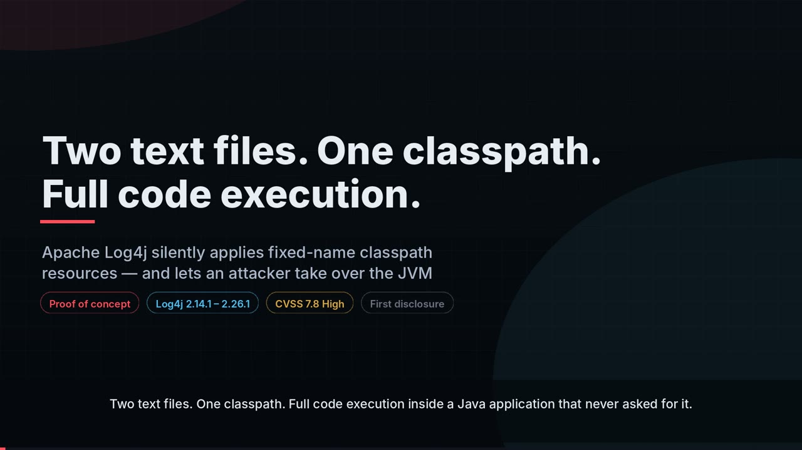
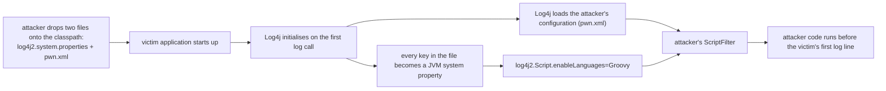
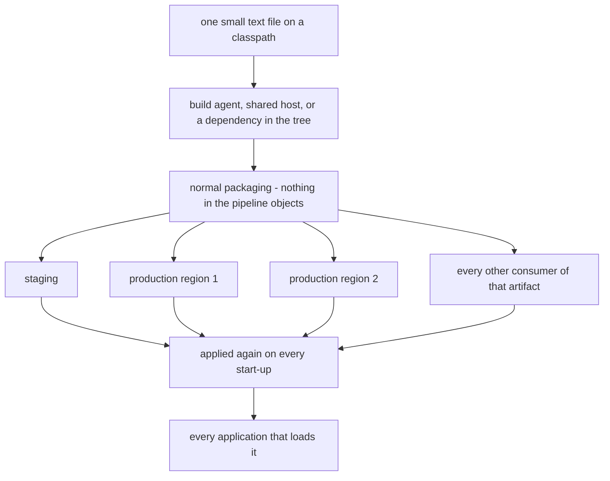

# Apache Log4j — the classpath resources Log4j trusts without asking

> **Disclosure status.**
> The behaviour itself is a documented Log4j convenience. The *security* consequence — that a
> classpath resource silently reconfigures the JVM and takes over Log4j's configuration — has
> not been reported to the Apache Logging Services project, not sent to any vendor, not shared
> with any third party, and not published in an advisory, mailing list post, blog, conference
> talk, preprint, issue tracker, or chat anywhere else.
>
> This finding was derived in the same audit as the configuration-time evaluation finding in
> <https://github.com/vindeckyy/log4j-config-time-lookup-rce>, and was moved into this
> repository for a separate disclosure. Both findings are reported together, on one timeline —
> see [`DISCLOSURE.md`](DISCLOSURE.md).
>
> If you run Log4j and this affects you, please forward this to the vendor:
> <security@apache.org> (the Apache Logging Services security process, per
> <https://logging.apache.org/security.html>).

## Proof-of-concept video

[](https://vindeckyy.github.io/log4j-classpath-plant-rce/)

**Two text files. One classpath. Full code execution.** — 8 minutes, 1080p, English narration with
burned-in captions. Click the frame to play it on the [player page](https://vindeckyy.github.io/log4j-classpath-plant-rce/),
or [watch the mp4 directly](https://vindeckyy.github.io/log4j-classpath-plant-rce/log4j-classpath-plant-poc.mp4),
or [download it](https://github.com/vindeckyy/log4j-classpath-plant-rce/releases/download/poc-video/log4j-classpath-plant-poc.mp4)
([`.srt`](video/out/log4j-classpath-plant-poc.srt) alongside).

The footage is captured from `lab/` when the video is rendered, so it shows the output the proof of
concept actually prints; every command in it runs on localhost.

| time | chapter |
| --- | --- |
| 0:00 | Cold open — the finding in one line |
| 0:26 | Background: what Log4j is, what the classpath is |
| 0:56 | The mechanism: the two fixed-name classpath resources |
| 1:33 | The payload: `log4j2.system.properties`, line by line |
| 2:01 | The attacker's configuration: `pwn.xml` |
| 2:25 | Proof of concept: the live exploit |
| 2:46 | The ordering: the payload runs before the application's first log line |
| 3:05 | Negative control: without the file, nothing happens |
| 3:20 | Blast radius: `log4j-api` alone, no `log4j-core` |
| 3:49 | Blast radius: the file travelling inside a dependency jar |
| 4:12 | Blast radius: outbound traffic redirected, credentials captured |
| 4:44 | Why it matters: five reasons |
| 5:40 | Comparison with Log4Shell |
| 6:07 | Reach: one file, every environment |
| 6:37 | What to do now: audit, remove, rebuild, harden |
| 7:31 | Disclosure |

Rebuild it with [`video/README.md`](video/README.md): the script is [`video/script.py`](video/script.py),
the renderer is [`video/build.py`](video/build.py).

**Component:** `org.apache.logging.log4j:log4j-api` (the property loader) and
`org.apache.logging.log4j:log4j-core` (the configuration it hijacks)
**Severity:** High
**CVSS 3.1 (base):** `AV:L/AC:L/PR:L/UI:N/S:U/C:H/I:H/A:H` = **7.8 (High)**

> **Why this vector.** The attacker's precondition is the ability to place a file on the
> victim's classpath — write access to a classpath directory, or control of an artifact in the
> dependency chain. That is a local write primitive, so the base vector scores it as
> `AV:L / PR:L` with no scope change: the impact stays in the trust domain the attacker already
> reached. **If the file is delivered through dependency resolution** — a poisoned artifact the
> build resolves — the environmental vector becomes `AV:N/AC:L/PR:N/UI:N/S:C/C:H/I:H/A:H` = 10.0,
> but that depends on the victim's build and is not the base case. The score above is the
> weakest-access variant, on purpose: it is the one the finding requires to be true.

**CWE:** CWE-426 (untrusted search path) → CWE-94 (improper control of generation of code) /
CWE-200 (information exposure)
**Affected:** `log4j-api` / `log4j-core` 2.14.1 – **2.26.1** (current release) — verified by
execution; the 3.x API source carries the same mechanism (source-level, see *Limitations*)
**Found:** 2026-10-23

---

## 0. In one sentence

**If someone can put one small text file onto your application's classpath, they can run their
own code inside your application — on the current Log4j release, with no attacker-supplied
request, and with no warning in the application's own log output (measured).**

That file is called `log4j2.system.properties` (or `log4j2.component.properties`). It is a few
lines of text. It looks like configuration. Log4j reads it automatically, before your
application has printed a single line, and then does what it says.

**The attacker's precondition is the ability to place that file on the classpath** — write
access to a classpath directory, or control of an artifact in the dependency chain. The score
in the header reflects that precondition; see the CVSS note there.

### What is measured here, and what is analysis

**Measured** — reproduced in `lab/`, asserted by `lab/verify.sh` (15 checks):

* code execution in the victim JVM on `log4j-core` 2.14.1, 2.17.1, 2.24.0, 2.25.1 and 2.26.1;
* the same result through `log4j2.component.properties` alone, and through the file travelling
  inside a dependency jar;
* the JVM's system properties being rewritten with **`log4j-api` alone** — no `log4j-core`, no
  logging provider;
* outbound traffic redirection, with a request carrying credentials captured by a proxy;
* a planted value that is itself a lookup expression being **evaluated recursively** at
  configuration time — the runtime guardrail does not extend to this input channel (§5);
* the negative control: without the file, nothing happens.

**Analysis** — derived from the mechanism, not reproduced here:

* how the file reaches a victim in practice (§4);
* which other properties an attacker can set (§9 lists the ones that were actually exercised).

---

## 1. What actually happens

You can read the whole attack in one diagram:



Step by step, in plain words:

1. **A file appears on the classpath.** A dependency jar, a deployment directory, a build
   workspace, the current directory of a start script — anywhere the JVM looks.
2. **Log4j finds it and obeys it.** `log4j2.system.properties` is copied into the JVM's system
   properties. `log4j2.component.properties` becomes Log4j's own configuration. No warning, no
   log line, no opt-in.
3. **The file picks the configuration.** One line — `log4j.configurationFile=pwn.xml` — makes
   Log4j load a *different configuration file* instead of the application's own. That file can
   be a resource inside the very same jar.
4. **The file enables code execution.** One more line — `log4j2.Script.enableLanguages=Groovy` —
   turns on script execution, which is off by default and which the attacker's configuration
   then uses.
5. **The attacker's code runs.** Inside your JVM, with your application's privileges, before
   your application has served a single request.

The measured output from the lab, running an ordinary application that has no Log4j
configuration of its own:

```
[1] planted system property BEFORE log4j init : null
=== PAYLOAD EXECUTED IN VICTIM JVM (planted config) ===
RCE via planted log4j2.system.properties (classpath pre-positioning) as hayden
uid=1000(hayden) gid=1000(hayden) groups=1000(hayden),4(adm),24(cdrom),27(sudo),...
=== END PAYLOAD ===
13:03:23 INFO  victim - first log statement triggers log4j initialization
[2] planted system property AFTER  log4j init : planted-by-attacker
[3] effective log4j config location             : pwn.xml
[4] script languages enabled                     : Groovy
[5] attacker script executed (marker file)       : true
```

Read the order again. **The payload ran before the application's own log statement was
rendered.** There was no window in which the application could have noticed.

---

## 2. Why this is so easy to miss

| what people expect | what happens |
| --- | --- |
| "Logging vulnerabilities need attacker data in my logs" | **No attacker data is needed at all.** The file is the attack. |
| "I would need a vulnerable Log4j version" | **No.** Log4Shell was closed in 2.17.1; this was not, and 2.26.1 — the release in front of you — is affected. |
| "My application doesn't use Log4j for output, so Log4j can't matter" | **`log4j-api` alone is enough.** No `log4j-core`, no appender, no configuration — the API prints *"Log4j API could not find a logging provider"* and still rewrites the JVM's system properties. |
| "I would see something in my logs" | **You would not.** `StatusLogger` prints nothing when it finds the file. Worse: the attacker's configuration replaces yours, so it also decides the log level and the log destination. |
| "I'd need to intercept or spoof something" | **No interaction is needed.** The victim never has to send a request, click a link, or restart on a schedule. |
| "It's one application, so it is one application" | **One file is applied by every application that loads it.** See §4 — analysis, not measurement. |

---

## 3. What the attacker gets once the file is in place

The file does not just run code once. It keeps control.

| | what the attacker has | how |
| --- | --- | --- |
| **Their own code, in your process** | arbitrary code execution with your application's privileges — database access, cloud metadata, credentials on disk, lateral movement | configuration hijack → script filter (measured, §7) |
| **Your application's outbound traffic** | every request your service makes — including credentials in URLs, headers and bodies — redirected to them | `http.proxyHost` / `http.proxyPort` set as JVM system properties (measured, §9) |
| **Your application's TLS trust** | outbound TLS intercepted, certificate pinning defeated by a replaced trust store | `javax.net.ssl.trustStore` (same mechanism; not separately exercised) |
| **Your application's logs** | the attacker's configuration decides what is logged, at what level, and where — so the trail of the compromise is under their control | the victim's configuration file is replaced (measured) |
| **Re-application on every start** | while the file remains on the classpath, it is applied again at every start-up, and it is carried by whatever artifact contains it | follows from the mechanism (§1) and from the file being in the jar or the deployment directory |

The last row is the one to sit with, and it is a property of the mechanism rather than a
separate measurement: this is not a race against a restart. A file inside a jar is deployed by
the normal release process, to every environment that consumes the artifact.

---

## 4. How far one file reaches — *analysis, not measurement*

The mechanism is general; what follows is the reasoning about how the file reaches a victim in
practice. It is **not** a measured compromise of a real pipeline, and no pipeline was tested.



The path that needs no luck:

1. A build agent or CI runner whose workspace is writable by another account. The attacker
   writes the two files into the build output.
2. The normal release process packages them. Nothing in a build pipeline inspects two small
   text files with familiar names.
3. Every environment that consumes the artifact inherits it — staging, production, every region,
   every replica.
4. On start-up, the attacker's configuration is loaded instead of the application's, and the
   attacker's code runs.

What is *measured* about this is the last step, in isolation: the file is applied at start-up,
the attacker's configuration takes over, and the code runs (§1, §7). What is *not* measured is
the pipeline that carries the file there.

The attacker never has to find the application, interact with it, guess a URL, or be lucky about
timing. That is why the classpath — not the application — is the thing to audit.

---

## 5. What Apache documents, and what it does not

This is the objection to expect first, so it is answered here rather than in a reply.

**What the documentation says.** The Log4j 2.x manual, *Configuration properties*
(<https://logging.apache.org/log4j/2.x/manual/systemproperties.html>), describes one line:

> *"If a `log4j2.system.properties` file is available on the classpath its contents are sourced
> into Java system properties at Log4j startup."*

That is accurate, and the code does exactly that. The file name, the classpath lookup and the
copy into the system properties are all documented or plainly visible in the source.

**What the documentation does not say.**

* It does not state that the classpath is a trust boundary — that anything on the classpath can
  reconfigure the JVM. The project's own threat-model page
  (<https://logging.apache.org/log4j/2.x/security.html>) enumerates what Log4j trusts and does
  not trust, and the classpath is not among them.
* It does not say that the file is applied to the **JVM's global namespace** rather than to
  Log4j's own namespace. "Sourced into Java system properties" reads like a convenience for
  operators; the consequence is that a classpath resource sets global JVM configuration.
* It does not mention that the same mechanism can point Log4j at a *different configuration
  file* (`log4j.configurationFile`) and enable script execution
  (`log4j2.Script.enableLanguages`) — the two properties that make this a code-execution path
  rather than a settings file.
* It does not say what happens when the file is found: the product prints nothing. There is no
  `StatusLogger` message, no warning, and no record that the file was applied.
* It does not say that the file need not come from Log4j. Any artifact on the classpath can
  carry one.

**Why this is a vulnerability and not a hardening gap.** The line between the two is whether the
vendor has stated a trust assumption that the reader can rely on. Here:

1. **The outcome is code execution.** A hardening gap is a setting that can be misused; this is
   a documented convenience that reaches code execution in the application JVM, through two
   properties the documentation never mentions in this context.
2. **The trust assumption is not written down.** "The classpath is trusted" is a defensible
   position for a library — but it is a position the reader cannot know, and the project's own
   threat model states its other assumptions explicitly.
3. **The product's own policy is circumvented.** Log4j deliberately refuses to evaluate lookups
   inside results on the runtime path, precisely because context data may be attacker-controlled.
   The classpath file delivers attacker-chosen values into a namespace that the *configuration*
   path does evaluate recursively, so a value smuggled in as a system property is evaluated by
   the configuration substitutor — the guardrail that protects the runtime path does not extend
   to this input channel. *Measured:* a planted `lab.leak=${env:HOME}` read back through
   `${sys:lab.leak}` in a configuration pattern comes out expanded (`LEAK=[/home/hayden]`), not
   as the literal expression — `lab/src/lab/PolicyProbe.java`, asserted by `lab/verify.sh`.
4. **It happens silently and by default.** No opt-in, no warning, no trace.

If the project considers the classpath a trust boundary, the reasonable outcome is a documented
statement to that effect, plus a `StatusLogger` warning when either file is found, plus an
explicit opt-in for the system-property copy. That is a small change, and it is the change this
finding is asking for.

---

## 6. The defect, for the people who read the source

`log4j-api` reads two resources by fixed name from the classpath during its own initialization.
Neither file has to be requested, enabled, or mentioned in the application's configuration, and
neither produces a warning:

| file | effect |
| --- | --- |
| `log4j2.system.properties` | **every key is copied into the JVM system properties** |
| `log4j2.component.properties` | Log4j's own properties — configuration file location, script languages |

`log4j-api` 2.26.1, `org/apache/logging/log4j/util/PropertiesUtil.java:506-519`:

```java
private Environment(final PropertySource propertySource) {
    final PropertySource sysProps = new PropertyFilePropertySource(LOG4J_SYSTEM_PROPERTIES_FILE_NAME, false);
    try {
        sysProps.forEach((key, value) -> {
            if (System.getProperty(key) == null) {
                System.setProperty(key, value);          // global JVM state, from a classpath file
            }
        });
```

The file is found on the classpath through `util/PropertyFilePropertySource.java:50-55` →
`util/LoaderUtil.java:461-491`, which searches the thread-context class loader, Log4j's own
class loader and the **system class loader** — the application's entire classpath, jars
included.

Two Log4j properties turn it into code execution: `log4j.configurationFile`
(`log4j-core` 2.26.1 `config/ConfigurationFactory.java:89`, read at `:457-460`) — the value may
name a **classpath resource**, so the attacker's configuration can travel inside the same jar —
and `log4j2.Script.enableLanguages` (`log4j-core` 2.26.1 `util/Constants.java:52`).

The 3.x API has the same code (`log4j-api` 3.0.0-beta2
`util/PropertiesUtil.java:70, 675-682`).

---

## 7. The chain to RCE, measured

The planted `log4j2.system.properties` (three lines):

```properties
lab.planted=planted-by-attacker
log4j.configurationFile=pwn.xml
log4j2.configurationFile=pwn.xml
log4j2.Script.enableLanguages=Groovy
```

The planted `pwn.xml` on the same classpath: a normal Log4j configuration whose `ScriptFilter`
runs a Groovy script.

| vector | file on the classpath | result |
| --- | --- | --- |
| A — JVM system properties | `log4j2.system.properties` | RCE, plus arbitrary JVM system properties |
| B — Log4j configuration | `log4j2.component.properties` | RCE (the file alone, without variant A) |
| C — supply chain | either file **inside a dependency jar** | RCE |

| log4j-core | 2.14.1 | 2.17.1 | 2.24.0 | 2.25.1 | **2.26.1** |
| --- | --- | --- | --- | --- | --- |
| RCE via planted classpath resource | yes | yes | yes | yes | **yes** |

Negative control — the same application without the planted file:

```
[2] planted system property AFTER  log4j init : null
[3] effective log4j config location             : null
[4] script languages enabled                     : null
[5] attacker script executed (marker file)       : false
```

---

## 8. The blast radius is `log4j-api`, not `log4j-core`

With **only `log4j-api` on the classpath** — no `log4j-core`, no appender, no configuration, and
the API reporting *"Log4j API could not find a logging provider"* — the planted file still
rewrites the JVM's system properties:

```
[api-only] planted property BEFORE log4j init : null
2026-10-23T17:03:44.240Z main ERROR Log4j API could not find a logging provider.
[api-only] planted property AFTER  log4j init : planted-by-attacker
[api-only] log4j.configurationFile             : pwn.xml
```

`log4j-api` is a transitive dependency of a large part of the Java ecosystem, so the exposed
population is "every application that has Log4j on its classpath", not "every application that
configured Log4j".

---

## 9. The plant reaches past Log4j

Because it sets **JVM** system properties, it reaches application behaviour that has nothing to
do with logging. With `http.proxyHost` / `http.proxyPort` planted, the victim's outbound request
went to the attacker's proxy:

```
--- victim stdout ---
[proxy-victim] http.proxyHost = 127.0.0.1
[proxy-victim] http.proxyPort = 8899
[proxy-victim] response status = 200
--- captured by attacker proxy ---
GET http://vault.internal/api/login?user=alice&token=s3cr3t HTTP/1.1
User-Agent: Java/1.8.0_504
Host: vault.internal
```

The credentials in the request URL were read by the attacker because a file on the classpath
said so. The same mechanism reaches `javax.net.ssl.trustStore` (the application's TLS trust
decisions), `https.proxyHost`, and any property a library reads lazily — those two were not
separately exercised.

---

## 10. Compared with Log4Shell

| | Log4Shell (CVE-2021-44228) | this finding |
| --- | --- | --- |
| Vulnerable versions required | yes — fixed in 2.17.1 | **no — the current release is affected** |
| Attacker-controlled data must reach the log path | yes | **no** |
| Thread Context Map involvement | in some variants | **no** |
| Application's configuration must be unusual | no | **no** — the configuration is what gets replaced |
| Any optional Log4j feature must be enabled | no | **no** — scripting is enabled by the planted file |
| Affects applications that only have `log4j-api` | no | **yes** |
| Leaves a trace in the logs | often (errors, outbound LDAP) | **no** — the attacker's configuration controls the logs |
| Needs the victim to do something | send a request | **no** |
| Delivery | a string in a request | **a file on the classpath** |
| Attacker's precondition | send a request | **write access to a classpath location, or control of a dependency** |

---

## 11. Is your estate exposed?

Answer these five. If any of them is "yes", treat it as an incident until proven otherwise.

1. **Do any of your applications have `log4j-api` on the classpath** — directly, or transitively
   through a library that logs through Log4j? (For most Java estates: yes.)
2. **Is any directory on an application's classpath writable by another account** — a shared
   deployment directory, a shared `lib/`, a build workspace, a container layer, a current
   directory used by a start script?
3. **Do your artifacts come from a pipeline where one account can write into the build output**?
4. **Do you have any `log4j2.system.properties` or `log4j2.component.properties` file anywhere**
   — on disk, or inside any jar in any dependency?
5. **Could a third-party dependency introduce one?** A single file in a jar is enough, and
   nothing about the artifact looks unusual.

## 12. What to do now

* **Audit every classpath** — every deployment directory, every container image, every jar in
  every artifact. A match is an incident, not a finding.
* **Remove the files** from artifacts and from deployment directories, then **re-build and
  re-deploy** the artifacts that contained them. Deleting the file from a running host is not
  enough — the next deploy brings it back.
* **Make the classpath a trust boundary.** Nothing on it may be writable by anyone other than
  the identity that runs the application. Verify every jar by checksum in CI, and verify the
  *contents* of the build workspace before packaging.
* **Keep scripting disabled** (`log4j2.Script.enableLanguages` unset). It is the execution path
  the plant uses, and an environment without a JSR-223 engine fails closed.

Upstream, Log4j should not silently promote a classpath resource into JVM system properties. At
minimum it should require an explicit opt-in, log a warning through `StatusLogger` when either
file is found, and refuse to take the configuration file location from a classpath resource.

---

## 13. Detection

* Find the files: `find / -name 'log4j2.*.properties'`, and inside every jar
  `unzip -l <jar> | grep log4j2`. `scan/scan_planted.py` does both (on disk and inside jars).
* Compare a running service's JVM system properties against the application's own configuration:
  any difference is the plant.
* Look for a Log4j configuration inside a jar or directory that the deployment did not put there.
* Look for outbound HTTP(S) from the application at start-up or at reconfiguration — a
  configuration that fetches a script from a URL is visible on the wire.
* `StatusLogger` messages: `Error running script …`, `No script with name … has been declared`.

---

## 14. Reproduce it (localhost only)

```bash
./setup.sh                 # fetch jars + the Log4j sources cited in WORKUP.md
./lab/build.sh             # compile the victims
./lab/verify.sh            # 15 assertions over every claim in WORKUP.md
```

By hand:

```bash
# the planted classpath resource + the attacker's configuration
ls lab/poison/                       # log4j2.system.properties, pwn.xml
CP=lib/log4j-api-2.26.1.jar:lib/log4j-core-2.26.1.jar:lib/groovy-4.0.24.jar:lib/groovy-jsr223-4.0.24.jar
java -cp "$CP:lab/build/victim:lab/poison" lab.ClasspathPoison
# -> PAYLOAD EXECUTED IN VICTIM JVM (planted config)

# the supply-chain case: the planted resource inside a dependency jar
java -cp "$CP:lab/build/victim:lab/build/evil-dependency.jar" lab.ClasspathPoison

# the traffic impact
python3 lab/proxy_capture.py java -cp "lib/log4j-api-2.26.1.jar:lib/log4j-core-2.26.1.jar:lab/build/victim:lab/poison-proxy" lab.ProxyVictim
```

All traffic binds to `127.0.0.1`. The lab contacts no third-party host, scans nothing, and
carries no target list. The command it executes in the victim JVM is `id`.

---

## 15. Repository contents

| Path | What it is |
| --- | --- |
| `DISCLOSURE.md` | the shared disclosure record for both findings: timeline, status, and the report text |
| `WORKUP.md` | the full write-up: root cause with `file:line` evidence, the measured exploitability matrix, the CVSS rationale, the target/reach/impact analysis, detection, remediation, and limitations |
| `lab/` | the proof-of-concept: victim apps, the planted classpath resources, the attacker-side proxy, and `verify.sh` |
| `scan/scan_planted.py` | finds planted Log4j classpath resources on disk and inside jars |
| `video/` | the proof-of-concept video: the script, the renderer, and the rendered `mp4`, `srt` and thumbnail |
| `setup.sh` | downloads the jars and the sources the citations point at |
| `lib/`, `sources/`, `lab/build/` | downloaded artifacts and build output, created by `setup.sh` and `lab/build.sh` — not stored in git |

A sibling repository, <https://github.com/vindeckyy/log4j-config-time-lookup-rce>, documents a
separate finding in the same project: configuration-time evaluation of untrusted Thread Context
Map data. Both are reported together — see [`DISCLOSURE.md`](DISCLOSURE.md).

---

## Related research

Other disclosures from the same author, each with a full write-up and a working
proof of concept:

- **[TP-Link Archer AXE300 — authenticated command injection (root RCE)](https://github.com/vindeckyy/tp-link-archer-axe300-command-injection-rce)** — OS command injection in the ISP Speed Test of a consumer router: one authenticated request yields a root shell on the network gateway. Includes a standalone PoC and the device internals.
- **[VIZIO SmartCast — unauthenticated LAN JavaScript execution and persistent internal-API control](https://github.com/vindeckyy/smartcast-backdoor)** — A LAN attacker gets code execution on the TV and durable control of its internal API, on hardware that ships a JavaScript app store.
- **[Apache Log4j — RCE via configuration-time evaluation of untrusted Thread Context Map data](https://github.com/vindeckyy/log4j-config-time-lookup-rce)** — Lookup on attacker-controlled data executes code during configuration parsing, plus a second impact: secret disclosure with no special configuration needed.
- **[Apache Log4j — log injection and record corruption](https://github.com/vindeckyy/log4j-log-injection)** — Three findings in the logging path itself: structured-data injection, 3.x attribute drift and JSON NaN, live-proven.

## 16. Scope and ethics

* Every server in this repository listens on `127.0.0.1`; no external host is ever contacted.
* The payload executes `id` and writes a proof file; it does not persist, spread, or scan.
* No third-party system was tested, scanned, or contacted at any point.
* These labs are for testing systems you own or are authorised to test. This finding needs a
  writable classpath entry or a poisoned dependency — that is the access condition, not a
  vulnerability in the target application.

---

## 17. Limitations

* Log4j 3.x is analysed at source level only: `log4j-core:3.0.0-beta3` needs
  `log4j-api:3.0.0-beta3`, which is not published (`log4j-api` stops at `3.0.0-beta2`), and the
  two do not load together. The 3.0.0-beta2 API source still contains the mechanism
  (`util/PropertiesUtil.java:70, 675-682`).
* The JMX variant was tested and rejected: the JMX agent reads its configuration during JVM
  start-up, before Log4j initializes. Properties the JVM reads at start-up are therefore out of
  reach; properties read lazily (proxy, TLS trust store, most libraries) are in reach.
* The plant needs a writable classpath entry or a poisoned dependency. That is the access
  condition; Log4j's contribution is that it trusts a fixed-name classpath resource implicitly,
  silently, and — for `log4j2.system.properties` — applies it as global JVM state.
* The script chain was demonstrated with Groovy; any other JSR-223 engine behaves the same.
* The pipeline path in §4 is an analysis of the mechanism, not a measured compromise of a real
  pipeline. No pipeline, CI system or shared host was tested.

---

## 18. License

Apache License 2.0 — see `LICENSE`.
